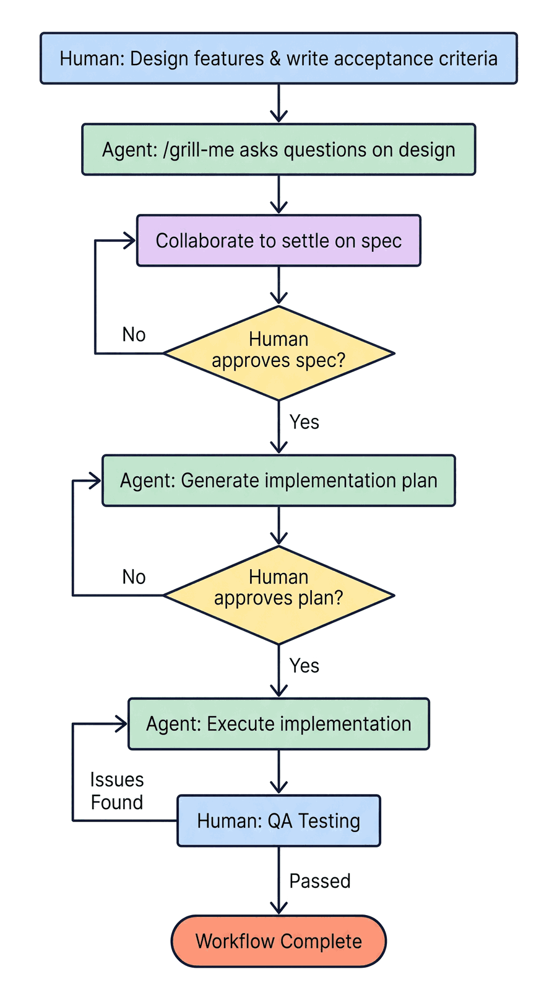
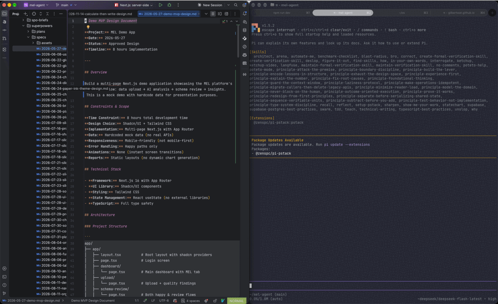
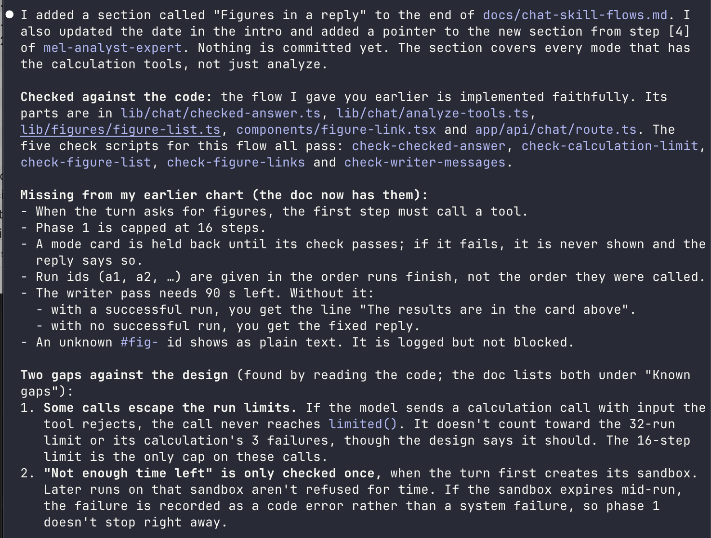
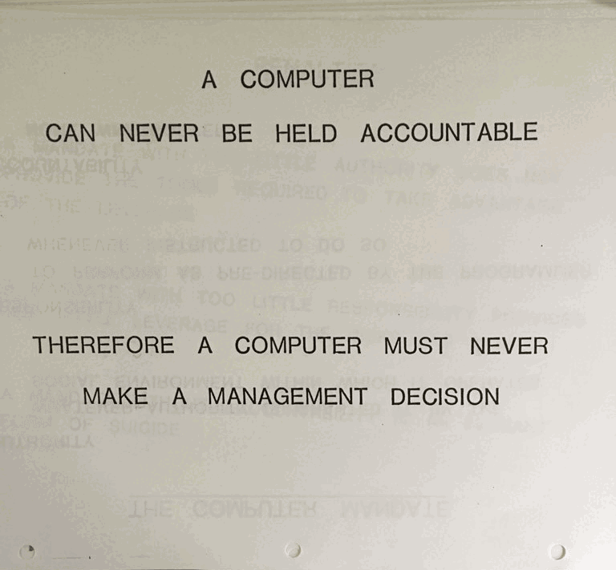

*The coding agent is speeding execution up — can we stay in control?*

## Preface

Last year, I concluded my previous startup journey in an EduTech startup as the figure head of the technology team. I was given a chance to go on a journey that I have put off for a decade - an entrepreneurial journey with 2 partners who have built quality digital products for over a decade. With the support of my family, I went all into it. It has been fascinating to be on the front line again.


Shared by our vision to use technology in the most needed sectors, we are privileged to partner with a capacity builder in the sector to build an AI harness. The scope is daunting with so much uncertainty. Hence I decided to take a very radical approach even to some of my most familiar spaces - software development and workflow design. Let’s dive into my software development workflow that I adopted and my honest review of it.

## Coding agent driven development flow

Since we are facing a super tight timeline of 6 months, I decided to use a revolutionary approach to software development and immersed myself into what I termed “coding agent heavy development”, it is something like this:



### Tools I used

Based on my experience and what I read online, I was convinced that all I needed to do was govern the system design, architecture and acceptance criteria. So I decided to not code by hand as much as I can. I only used a coding editor mainly to edit the execution plans and architectural decisions. For other operations, I stayed inside the coding agent.

After the implementation, I use Github pull requests to govern the output from the LLM, but only read as thoroughly as I could some critical components of software, such as the database queries with proper authentication, the backend logics, the boundary between deterministic code and llm generation, and the hands-off modules to the third party providers. The frontend code is a mess as a result.

During the development, I added more guardrails and agent skills as I went.



#### SKILLs

I did not use a lot of fancy SKILLs in my development workflow. I heavily leveraged superpower to design the spec and implementation plan. I also experimented with pstack later in the stage and it is a hit or miss to me. I won't go deeper into these skills here. There are already numerous tutorials to those SKILLs. They have done a better job than me.

In the later stages, I added “grill-me” to the workflow but there are too many false positives. As a result, my design bloated unnecessarily. I still keep it as a catch-all phase to govern if I am not proper in my designs and fill up some areas that I had not put enough thoughts into.

#### Guardrails

`index.md` is a document to provide an overview to the entire codebase and how the agent should navigate it. This is quite core to the LLM to gain relevant context and guidance on where it should put its attention.

ADRs (Architectural Decision Records) are where I store all the architectural decisions and changes. The LLM references it first when they are generating the spec for my review, and also in the checking phase, it references it to verify itself if there is architectural drift.

Post-mortem has been the most challenging type of document I am introducing. Post-mortems usually include production issues and the journey to trace, the resolution and the communication around the incidents, but for the sake of assisting agentic development, I have also included accidental access to production, unintended changes and all new kinds of incidents related to agentic development workflow that I have encountered.

I leave AGENTS.md very plain and simple.

One of the regrets I didn't put in earlier is that I don’t use react-best-practices in the first place. `useEffect` is now used everywhere and some of the db queries are outside the designated folders, Also I only recently discovered modern-web-guidance. These are the 2 SKILLs that will potentially improve the quality of the codebase.

#### Testing Suites

Originally I didn't set up a proper testing framework, I was proven wrong: the agent changed some key behaviors in an unrelated update in the codebase. After this incident, I set up a rudimentary test suite. It is a sleep saver. Even if I don't set up a proper testing framework, the test suites are already good enough for me to govern the implementation.

In this space I definitely can do a better job in introducing proper test suites and govern the project in a more structured and thoughtful manner from the testing perspective.

## Exhilaration: I’ve got the power

After sharing my tools, I can move on to share my actual development experience. It started as a very satisfying experience, I can go so fast with the power of a coding agent. At one point of my development, I have 3-5 agents all running intertwining updates to our codebase, and I know I am not having the most agents running development tasks.


As the pilot program proceeded, we did 3 iterations of user interface, and 2 major scope increases, all based on the feedback from the test users. In a timespan of 6 months, we originally planned to ship a knowledge management and data cleaning AI harness for NGOs, with deployment options to be secure on premise. We also expand the scope and capabilities of our AI harness to support proposal writing, indicator tracking, report writing activities and survey design.

The reason behind this is simple: we discovered with our pilot partners the original scope is not enough to have an impact on their organization. We need some tangible outcome. We also need to bring a more tailored UX to guide our users to use our product. We also need to engage the users in terms of frequency. And then we add more. And more. And even more.

If I can get 2 features done in 2 days, compared with 3 weeks, why are we prioritizing properly when we can have both?

I feel like we are too ambitious, and it is not necessarily bad - now I know the limit of coding agents and what is the real cost of our product development - It is the cognitive load and limit of human understanding, and also human judgement and the cost that come with it. The effect doesn’t show up right off the bat, but it subtly creeps into my life.

## Exhaustion: Absolute Power corrupts absolutely


Right from the beginning, I already face a synchronization problem that only occurs in bigger teams. In the local environment, there is no way to do proper infrastructure spin off per agents as I go faster and faster. For example, I am altering the relational tables in the database, I need to do zero down-time migration or have each version of code with a separate db instance if I need to do it properly. This leads to some very undesirable outcomes - the agent cannot contribute safely without a mess to merge, from db migration numbering to logic contradiction. Although the agent output is already in a git worktree, the problem is the complexity of logic which none of the technology can offer a good enough solution to me.

I originally “tokenmax” myself and go full speed in software development mode. When I went on in full speed, I was given more and more tasks for myself, as a founder would. As time went by with so many solutions in my head and the speed of implementation, I gradually lost my ability to think them through. Some easy system designs I needed to spend a whole day on and they missed a great deal of details, resulting in reworks for some of the critical features. I gradually lost the steam and it is even hard for me to type, “new task: …..”.

To further illustrate the situation, the hard part is definitely the verifying and designing part of the job. As a seasoned tech lead, you might already know reading someone else’s code diligently is more mentally challenging than writing the code yourself. The day passes by so fast and it seems I am working the whole time. I also find myself unable to write a complete sentence with complete logical thoughts. I also lose my patience in typing out simple sentences.

I need to do something to regain my sanity, to put it mildly exaggerated.

After this “episode”, only then I understand, the speed of development has overloaded my cognitive ability and it is hard for me to contribute meaningfully in the other areas of my life and business.

## The real cost of building with agent

### Financially, The token is burning faster as the codebase bloat

As the codebase is growing, some of the debugging seems very very slow, unexpectedly slow even for stronger models. This is a very telling sign that the LLM has to go across a lot of contexts to debug a simple thing. “Time to refactor and fix what is underneath it.”, said the engineer side of me. But of course the founder side of me said, “Let’s complete the feature first to ship the MVP.” As a corollary, the debugging is taking longer as there is more inaccurate diagnosis and patching the wrong place.

### Technically, The volume of changes to be governed is astronomical

Also some of the telling signs of code rot is, when you are trying to trace a bug manually, you simply cannot reason why it is written like this, and you have to go through the ADR and compare with the real implementation that usually comes with the size of the following diff in 1 pull request.


In this scale of changes, we cannot read through all changes meaningfully. And my understanding of the codebase rot, and if I cannot read through the part of code, how can I debug without the help of LLM?

Even in the old days, when the team is going super fast, for an inexperienced team lead, the codebase will turn into a bundle of entangled concepts and features that can be very hard to debug.

So even though I am using the best model available for me, I “sensed” that there is trouble from time to time, for it was not performing at the level that it used to be. For example, the spec it outputs, the plan it outputs and the pull request is so off the charts bad that I need to rework the whole thing. Given the tight deadline of course I am not very impressed.

One day the coding agent is your best partner, the next day it is your technical debt slop-piler.

Also, LLM cannot generate a novel design. For example, in the analytics SKILLs inside Agent MEL, we have gone through 3 iterations with 1 of them dropped completely. In the task and context management module, we also have gone through 2 iterations too. Both of them have no precedence and it is hard for the AI to do a proper design on these novel areas. After the implementation, I also asked the LLM itself to check if the code faithfully implemented the system design, but again, the “verification” is some pattern matching that offers no guarantee and credibility. All you can say is the implementation has an X% of chance it is implemented according to the design.



### Team dynamically, No one can be all rounded as a Designer-Developer-QA-PM-Data

The power I got also backfired as a team, I was going so fast and my designer partner was having a hard time following, same went for his side on the design. We needed to constantly synchronize to make sure our context is shared. And the bottleneck becomes the sync.

This power that AI gives me used to be my biggest pride. But after a year, I don’t think this is the right way of doing things, yes there should be a shared context and those functions should cross-pollinate as much as we can, but the quality of those decisions are very bad now as development is going so “fast” in terms of speed only. I do see a lot of blind spots even from me, a startup technology veteran that is supposed to have the biggest area of experience in building products.


Without a healthy boundary of responsibility, there is too much overlapping and too much disruption for teammates to talk to each other healthily.

To extend the previous point, who needs prioritization in the day of AI? We can build everything! But in reality, as we go faster, the complexity compounded as well as the technical and cognitive debt. Some may argue we can ask agents to just navigate through those technical debts, but it is proven to be a token burner. Not to mention that the product quality suffers as a result.

But I am now arguing with “the force of the market”, which I should stop right here to prevent my ranting to distract us.

### Personally, I am either burned out by the speed of AI or cognitively surrendered to the AI

Call me old but there is a constant nagging in the back of my mind, ”the code built by AI is not up to the standard of myself, even the software runs perfectly fine at the get go.” As I grew more exhausted, most of my decision quality lowered significantly and my governance was reduced to the product function level.

## The excitement co-exist with the deep challenges

With all the exhilaration and exhaustion, I distilled a few questions I discovered and I still don’t have the answers. I am sure those are legit but no one has the time to figure it out before the AI bubble bursts.

### How should teams prioritize when creating something takes a fraction of the time?

Of course you can say you are bound by the token you are allowed to use. But think about the code you are responsible for. All of a sudden this old teaching from the 70s comes into play:



Without prioritization, the coding agent allows you to indefinitely over-engineer and over-build a product.

### Should the tech team be accountable for the system design and the features we develop?

In the speed of generating code now, creating seems to be cheap now. But are we creating security holes, performance bottlenecks and other externality to the system unknowingly? If the tech team is “forced” to “tokenmax” but they are still accountable for the outcome of a good system design and feature integration: speed, scalability and reliability, they are put in a sure lose situation.

Also without coding as an act of doing, how can we discover better abstractions and ways to communicate with the machine our human intents, and share the knowledge with our fellow humans? How can we build the taste and judgement of system design and architecture? Without coding as an act of doing, how can we train our juniors to smell the architecture defects and design defects on a manual level, after all a developer should be “owning” a certain area of code and be knowledgeable to all the changes to it.

To illustrate my case, AI can now write almost perfect code, but the problem is without writing crappy code on the job, how can junior developers develop the “taste and judgement” that the AI guru is telling the crowd about what will be important in the coming years of the workforce?

For example,

`export async function archiveSourceAction(sourceId: string): Promise<void> {`

I am always particular on function naming but my coding agents always suggest some over complicated naming conventions, here I prefer without the `Action` in the function name and place `uuid` as the type of `sourceId` .

On a more architectural level, For example in the ADR,

```
ADR-018's runAnalysis reads one sheet of one source per call. A question
that compares datasets — matching T3 survey respondents to T1 respondents —
could only be computed by carrying one result into the next call's code. On
Production the model pasted 919 student keys into three successive calls. The
copy was complete that time, but it is lossy in principle, it made the chat
large enough that every later turn ended without a reply, and its gender test
("FEMALE".includes("MALE")) silently matched boys only.
```

In this quality of writing, it may be very challenging for humans to read and understand it. And some of the writing is not even about architectural decisions, but a bug.

## Conclusion

The above are just some challenges that I don’t have answers to, I will leave those questions as questions.

Another trend I predict is: the more I am convinced software engineering is turning into an athletic career: the more you get into software development, the more you need to manage your whole lifestyle to keep your decision and judgement sharp. In an era of execution so fast, the speed of governance and the quality of judgement becomes a scarcity and we as technologists have to stay very vigilant on the state of our mental and cognitive capacity.

Taking a necessary step to catch my breath, I am grateful I am not breathing down my neck to tokenmaxx without a problem to solve. I am also grateful that I got the opportunity to expose myself to the “new era of software development”. Let’s navigate this turbulence with solid work and build a useful product and fun games with all the cool tools available, as we always do without all the noise before.

*Acknowledgement: In this article, I only use AI to proofread.*

## Further Reading / Watching

- [How to Avoid AI Brain Rot — Miles Cranmer](https://youtube.com/watch?v=uXC7OuCas2Q&si=QofOWe7xYzBvW6lN)
- [Cognitive Surrender — Addy Osmani](https://addyosmani.com/blog/cognitive-surrender/)
- [Therac-25 technical report, UNC CS TR86-020](https://www.cs.unc.edu/techreports/86-020.pdf)
- [Surrender — knlb](https://knlb.dev/essays/surrender)
